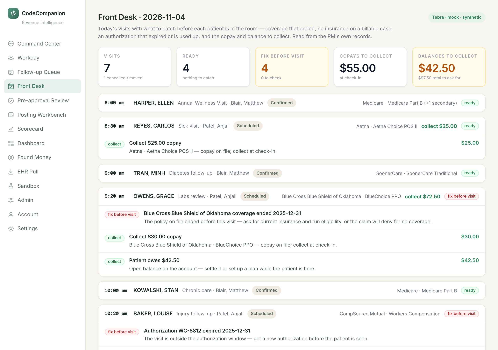
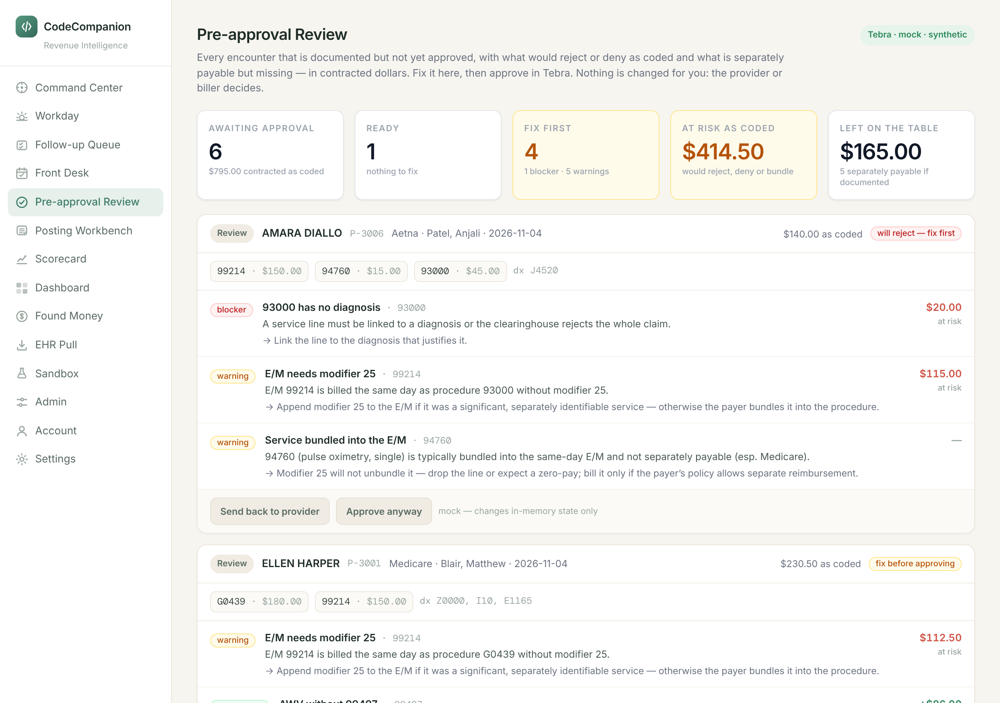
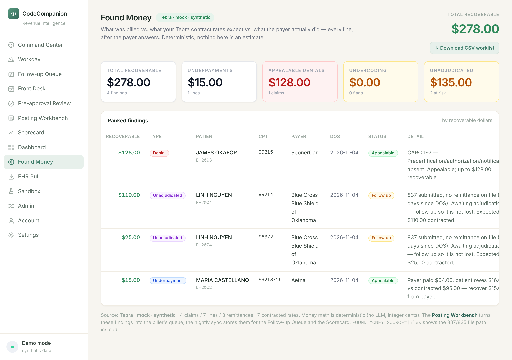
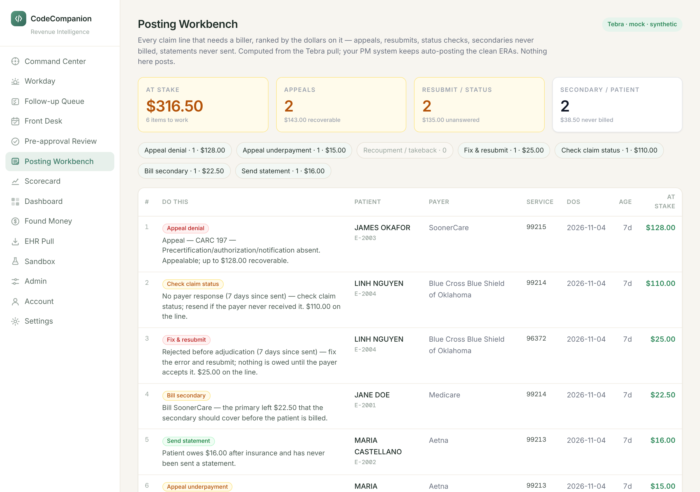
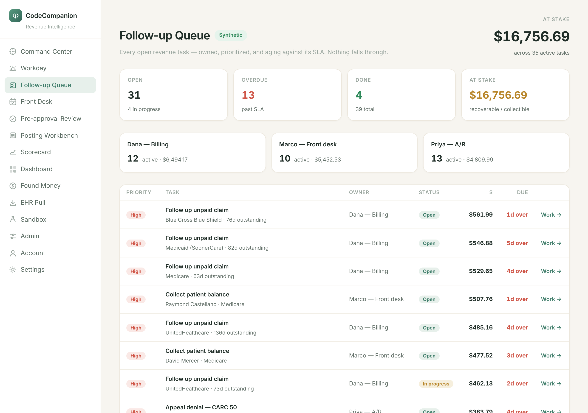
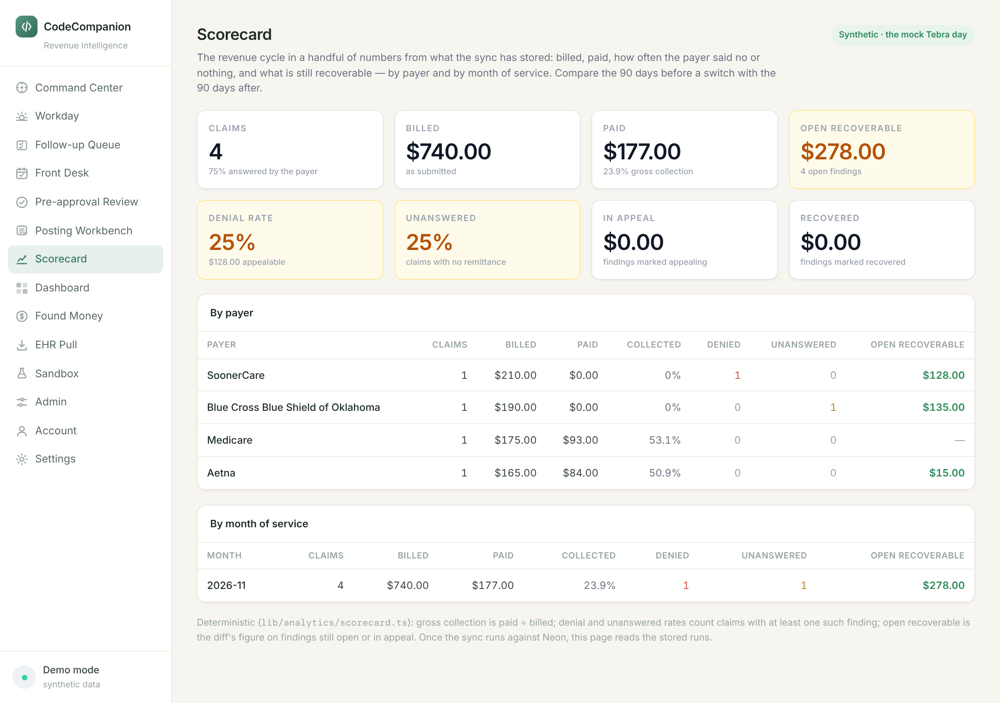
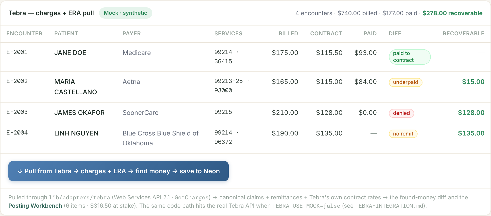
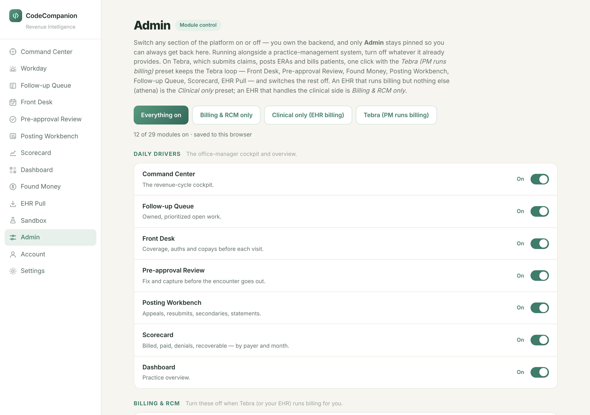

# Running the practice on Tebra with CodeCompanion

A walkthrough of the CodeCompanion dashboard for the people who use it every day: the front desk, the providers, the biller, and the owner. Tebra is the system you chart, bill and post in. CodeCompanion sits beside it, reads what Tebra holds, and tells you what to catch, fix, chase and appeal, with the dollars on every item.

Draft for review, November 2026. Screenshots are from the synthetic demo day; live screens look the same with the practice's own patients and payers. Edit `TRAINING-MANUAL.md` and run `npm run training:pdf` to republish.

> [!NOTE]
> **What CodeCompanion never does.** It never changes a charge, posts a payment, sends a claim or bills a patient. Those stay in Tebra. The one thing it can write back is an encounter's status, approving it or sending it back to the provider, and only when that switch is turned on. Every dollar on every page comes from arithmetic over Tebra's own numbers, never from an estimate or an AI model. The AI only drafts letters, and the figures in those letters come from the arithmetic.

## 1. The loop, in visit order

Every page follows the visit from the schedule to the bank. Each page answers one question for one person.

| Page | Who | The question it answers | When |
|---|---|---|---|
| **Front Desk** | Front desk | What do I catch before this patient is in the room? | Every morning, before the first patient |
| **Pre-approval Review** | Provider, coder, biller | What would reject or deny as coded, and what is missing, before the claim goes out? | End of day, before approving charges in Tebra |
| **Found Money** | Biller, owner | Where did the payer pay less than the contract, say no, or say nothing? | After payers answer, weekly |
| **Posting Workbench** | Biller | What exactly do I do next, ranked by dollars? | Daily |
| **Follow-up Queue** | Everyone | Who owns each open item, and is it overdue? | Daily |
| **Scorecard** | Owner | Is the revenue cycle getting better or worse, by payer and by month? | Monthly, and 90 days after the switch |

For now the app opens at its address without a sign-in; staff accounts arrive with the new login provider, and the pages are the same either way. The left sidebar lists the pages above, plus EHR Pull, Admin and your account. Everything else that used to be in the sidebar (claims submission, clearinghouse, enrollments, eligibility, patient billing) is handled by Tebra and has been switched off.

> [!TIP]
> **The daily rhythm in one line.** Front desk opens Front Desk at 7:30. Providers finish notes and charges in Tebra. The biller opens Pre-approval Review before approving anything, then works the Posting Workbench top to bottom and marks tasks in the Follow-up Queue. The owner reads the Scorecard on the first of the month.

## 2. How Tebra and CodeCompanion fit together

Tebra does the work of billing. CodeCompanion watches that work.

| Step in Tebra | What CodeCompanion does with it |
|---|---|
| The schedule and each patient's insurance, authorizations and balance | **Front Desk** flags what is missing, expired or owed before the visit |
| Charges entered on an encounter, in Draft or Review status | **Pre-approval Review** checks the coding against the clearinghouse edits and your contract rates |
| The encounter is approved and Tebra sends the claim through its clearinghouse | CodeCompanion tracks it as pending, rejected, or awaiting a response |
| The payer answers and Tebra auto-posts the ERA | **Found Money** compares billed, contract-expected and paid, line by line |
| Balances move to the secondary payer or the patient | **Posting Workbench** lists secondaries never billed and statements never sent |

The connection is a nightly pull from Tebra's reporting API, around 1 to 2 am Central. It reads charges, adjudication, the schedule and coverage. It does not sit inside Tebra, and nothing in Tebra looks different because of it. The EHR Pull page has a button to refresh by hand during the day; staff rarely need it.

> [!WARNING]
> **Contract rates make the numbers real.** CodeCompanion reads your contracted allowable per code from Tebra's Contract Rates table (Settings, Contracts and Fees). Tebra ships that table empty. Until the rates are loaded, denials and unanswered claims still show, but underpayments cannot, and the "as coded" dollars on the review page fall back to the billed charge. Loading the rates is a go-live task, not a nice-to-have.

## 3. Front Desk

Open it first thing every morning. It shows today's schedule from Tebra with what to catch before each patient is in the room.

**The five numbers at the top.** Visits still expected today, how many are ready with nothing to catch, how many need something fixed before the visit, copays to collect, and balances to collect. The last two add up to the total you should ask for at check-in.

**Each visit card** shows the time, patient, reason and provider, the status from Tebra (Scheduled, Confirmed, Checked in, and so on), the primary payer and plan, the amount to collect, and a badge:

- **ready**: nothing to catch.
- **check**: something to confirm before the visit.
- **fix before visit**: the visit will not get paid as things stand.

Cancelled, rescheduled and no-show visits are dimmed and not reviewed.

**The flags and what to do about them, in Tebra**

| Flag | Badge | What to do |
|---|---|---|
| No insurance on file | fix before visit | Get the card, enter the policy in Tebra and run eligibility, or mark the case self-pay |
| Coverage ended before this visit | fix before visit | Ask for current insurance; the claim will deny for no coverage otherwise |
| Coverage starts after the visit date | check | Confirm the effective date with the payer |
| Policy has no member number | check | Copy it from the card into the policy; claims without it reject |
| Authorization expired | fix before visit | Get a new authorization before the patient is seen |
| Authorization visits used up | fix before visit | Ask the payer to extend it, or the visit denies |
| Authorization ends within 14 days | check | Request the extension now so the next visit is covered |
| Workers comp, auto or liability visit with no authorization | check | Confirm the authorization or claim number before the visit |
| Collect copay | collect | Collect at check-in; the amount is the copay on the policy in Tebra |
| Patient owes a balance | collect | Settle it or set up a plan while the patient is here |

Real-time eligibility is still Tebra's own check against its clearinghouse. This page tells you when what is on file is not enough. Fix the record in Tebra, and the flag clears on the next pull.

## 4. Pre-approval Review

Open it before approving charges in Tebra. It lists every encounter that is documented but not yet approved, with what would reject or deny as coded and what is separately payable but missing. Every item carries contracted dollars.

**The five numbers at the top.** Encounters awaiting approval and their contracted value as coded, how many are ready, how many need a fix first with the count of blockers and warnings, the dollars at risk as coded, and the dollars left on the table.

**Each encounter card** shows the status in Tebra (Draft or Review), the patient, the encounter number, payer, provider and date of service, the contracted value as coded, and one verdict:

- **will reject, fix first**: a blocker. The clearinghouse would reject the claim as coded.
- **fix before approving**: a warning. The payer would deny or bundle something.
- **review opportunities**: nothing wrong, but something may be separately payable if the note supports it.
- **ready to approve**: nothing to fix.

Below the codes, each finding shows its badge, the code it concerns, a plain explanation, a hint on the fix, and the dollars: red for at risk, green with a plus sign for available if documented.

**The rules and how to act on them**

| Finding | Badge | What it means |
|---|---|---|
| A code has no diagnosis | blocker | Link the line to the diagnosis that justifies it, in Tebra |
| A code has no charge | blocker | The practice fee schedule is missing this code; add it, then re-enter the charge |
| A code appears twice | warning | Combine into one line with units, or add 76, 77 or 59 if it was really repeated |
| Problem visit with a preventive visit needs modifier 25 | warning | Append 25 to the office visit; the note must show a separately identifiable problem |
| Vaccine administration without a vaccine product | warning | Add the vaccine product code; for VFC stock, add modifier SL |
| Bundled pair, units over the limit, telehealth modifier, invalid NPI | blocker or warning | The clearinghouse edits; the detail line names the exact fix |
| Vaccine billed without an administration code | opportunity | Add 90471 (or G0008 for Medicare flu); the shot is paid separately |
| Documentation may support the next E/M level | opportunity | The provider confirms the level from the note. Never upcode without the documentation |
| Annual Wellness Visit without G0444 or 99497 | opportunity | Bill the depression screening or advance care planning only if it was done |
| Medicare visit-complexity add-on G2211 not billed | opportunity | Add it when this provider is the continuing focal point for the patient's care |

> [!WARNING]
> **"If documented" means exactly that.** An opportunity is a prompt to check the note, not an instruction to bill. The provider decides. Nothing on this page changes a charge.

**Approving.** Editing stays in Tebra: open the encounter, make the change, and approve it there. When the write-back switch is on, each card also offers two buttons: **Send back to provider**, which sets the encounter to Rejected in Tebra so the provider sees it needs attention, and **Approve in Tebra**. On an encounter that would reject, the button reads Approve anyway and asks you to confirm. Either way, Tebra then builds and sends the claim on its normal schedule.

The footer of the page says which edit tables are loaded. Until the CMS bundling tables are loaded it runs on a starter set, which is enough to learn the page but not to clear a payer.

## 5. Found Money

After the payer answers, this page compares three numbers for every service line: what was billed, what your contract rate says the payer owes, and what the payer actually did. The difference, ranked by dollars, is the money to go get.

**The four kinds of finding**

| Type | Meaning | Status column |
|---|---|---|
| **Underpayment** | Paid, but less than the contract rate. Patient responsibility (copay, deductible) is not counted as a shortfall | Appealable |
| **Denial** | The payer said no. The reason code decides whether it is appealable or terminal | Appealable, Open or Terminal |
| **Unadjudicated** | The claim went out and nothing came back. Timely-filing clocks are running | Follow up |
| **Undercoding** | After the fact, the diagnoses and lines suggest the visit may have supported a higher level | Chart review |

**Drafting an appeal.** On any appealable denial, click **Draft appeal**; on an underpayment, click **Draft request**. A window opens with the letter. The badge says whether it was an AI draft or the offline template. Read it, click **Copy**, and send it the way the payer requires: the payer portal, fax, or a corrected claim from Tebra. Then note the appeal on the claim in Tebra so the biller does not chase it twice. The dollar figures in the letter are the engine's, not the model's.

**Download CSV worklist** gives the biller the same list as a spreadsheet. It contains claim numbers and patient names, so it stays inside the practice.

The badge next to the title says where the numbers came from: the Tebra pull, live or synthetic, or an 837/835 file load for history.

## 6. Posting Workbench

The biller's daily list. Every claim line that needs a human, ranked by the dollars on it, with the exact next action written out. Tebra keeps auto-posting the clean remittances; this page is only the exceptions.

**The seven kinds of work and where to do them in Tebra**

| Do this | What it means | Where it gets done |
|---|---|---|
| **Appeal denial** | An appealable denial from Found Money | Draft the letter on Found Money; send it; note it on the claim in Tebra |
| **Appeal underpayment** | Paid below contract | Draft the reprocessing request on Found Money; call or portal; cite the contract rate |
| **Recoupment / takeback** | The posted payment went down since the last pull | Find the reason on the remittance in Tebra (duplicate, coordination of benefits, audit, offset); rebill or appeal |
| **Fix & resubmit** | Rejected by the clearinghouse or payer before adjudication; nothing is owed yet | Open the rejected claim in Tebra, fix the error named in the rejection, resubmit |
| **Check claim status** | Sent and accepted, but no answer after 30 days | Payer portal or phone; if they never received it, resend from Tebra |
| **Bill secondary** | The primary left a balance and the secondary on file was never billed | Submit the claim to the secondary from Tebra (Medicare to SoonerCare crossovers included if they did not cross automatically) |
| **Send statement** | The patient owes after insurance and no statement has gone out | Generate the statement in Tebra |

Work from the top. The first column is the rank, the **Age** column is days since the line was sent or served, and **At stake** is the contract rate, the posted balance or the finding's recoverable amount. When the list says nothing needs a biller, every line is paid to contract and billed through.

## 7. Follow-up Queue

Every open item as a task with an owner, a priority and a due date, so nothing falls through. The nightly pull keeps it current.

**Where tasks come from.** Every Posting Workbench item and every Pre-approval Review encounter that must be fixed before approval becomes a task. Each night the dollars, title and priority refresh from the engine, but the owner, status and due date a person set are kept, and tasks that stop applying close themselves.

**Priority and due dates** are set by the dollars: high above $150 with 7 days to act, medium above $60 with 14 days, low otherwise with 30 days. Overdue tasks sort to the top in red.

**Default owners** are the A/R role for appeals, Billing for resubmits, status checks and review fixes, and Front desk for secondaries and statements. Type a name in the **Owner** box to reassign. Change the **Status** dropdown to In progress when you start and Done when it is finished. **Work** opens the page where the item lives.

The badge next to the title reads From the sync once the nightly pull is running against the practice database. Before that it shows a synthetic queue for training.

## 8. Scorecard

The revenue cycle in a handful of numbers, by payer and by month of service. This is the yardstick for the Tebra switch: compare the 90 days before with the 90 days after.

| Number | How it is computed |
|---|---|
| **Claims** and **answered by the payer** | Claims in the stored runs, and the share with a remittance |
| **Billed**, **Paid**, **gross collection** | Totals as submitted and as paid; paid divided by billed |
| **Open recoverable** | The engine's recoverable figure on findings still open or in appeal |
| **Denial rate** and **appealable** | Claims with at least one denial, and the dollars on the appealable ones |
| **Unanswered** | Claims with no remittance at all |
| **In appeal** and **Recovered** | Findings whose status has been marked appealing or recovered |

Watch three lines month over month: gross collection up, denial rate down, unanswered down. By payer, the table shows which payer is leaving the most open recoverable, which is where the biller's week should go.

## 9. EHR Pull and Admin

**EHR Pull** is the connection page. The panel titled Tebra, charges + ERA pull shows the last pull: each encounter with billed, contract and paid, a Diff badge (paid to contract, underpaid, denied, or no remit) and the recoverable amount. The blue button pulls fresh from Tebra, runs the diff, and saves it, which is what the nightly job does on its own. The page still carries the earlier athena and clearinghouse test panels above and below; staff only use the Tebra panel.

**Admin** controls which pages appear in the sidebar. The **Tebra (PM runs billing)** preset is the one this manual describes: it keeps the loop pages and switches off everything Tebra handles. Individual pages can be toggled below the presets. Admin itself can never be turned off, so you can always get back to it.

## 10. When something looks wrong

| You see | What it means | What to do |
|---|---|---|
| A yellow box saying Schedule, Review or Workbench unavailable | The pull from Tebra failed | Note the message and tell the owner; the usual causes are the API user's password or permissions |
| The badge reads Tebra, mock, synthetic on a day it should be live | The app is running on demo data | Tell the owner; the live switch is set in the environment, not on the page |
| No encounters are waiting for approval | Nothing in Tebra is in Draft or Review | Correct; there is nothing to review |
| Nothing needs a biller | Every line is paid to contract and billed through | Correct; check Found Money for history |
| Finding not found when drafting an appeal | The list changed since the page loaded | Reload the page and click again |
| The footer says the bundling tables are seed | The CMS edit files are not loaded yet | The owner loads them; bundling flags are incomplete until then |
| An opportunity you know is wrong for this patient | The rule is conservative by design | Ignore it; the provider decides from the note |

## 11. Glossary

- **Encounter.** One visit's charges in Tebra, with a status: Draft, Review, Approved, Rejected.
- **Claim.** The encounter as sent to the payer. Tebra sends it through its clearinghouse.
- **ERA (835).** The payer's electronic remittance: what they paid and why, line by line. Tebra posts it automatically.
- **Contract rate, allowed amount.** What your contract with the payer says they owe for a code. Loaded in Tebra's Contract Rates table.
- **Underpayment.** Paid less than the contract rate, after patient responsibility is taken out.
- **Denial.** The payer refused the line. The reason code (CARC) decides whether it is appealable or terminal.
- **Rejection.** The claim never reached adjudication; the clearinghouse or payer bounced it for an error. Fix and resubmit; nothing is owed yet.
- **Unadjudicated, no response.** Sent, accepted, and no answer. Timely-filing limits are counting down.
- **Recoupment, takeback.** The payer reversed money it had paid.
- **Secondary, crossover.** A second payer billed for what the primary left. Medicare often crosses claims to SoonerCare automatically; when it does not, the secondary must be billed.
- **Copay, coinsurance, deductible.** The patient's share. Collected at check-in or billed after insurance.
- **Modifier 25.** Marks an office visit as separate from a procedure or preventive visit done the same day.
- **NCCI, bundling, MUE.** CMS rules on code pairs that cannot be billed together and the maximum units per code.
- **AWV, G0444, 99497, G2211.** The Medicare Annual Wellness Visit, its depression screening and advance-care-planning add-ons, and the visit-complexity add-on.
- **SLA.** The number of days a task is allowed to sit before it is overdue.

## Appendix. Owner's notes

**Switches that change what staff see.** They live in the environment, not on any page, and are documented in `TEBRA-INTEGRATION.md` and `.env.local.example`:

- `TEBRA_USE_MOCK=false` with the Customer Key, API user and practice name turns the pages live. `ALLOW_REAL_PHI=true` must be set with it, and only on the practice's own hosting, never on the public demo.
- `TEBRA_ALLOW_WRITES=true` turns on the Approve and Send back buttons on the Pre-approval Review.
- `TEBRA_SYNC_ENABLED=true` turns on the nightly pull.
- `TEBRA_CONTRACT_EXPORT_PATH`, `NCCI_PTP_PATH` and `NCCI_MUE_PATH` point at the contract export and the CMS edit files.
- `FOUND_MONEY_SOURCE=files` points Found Money at 837/835 files instead of the Tebra pull, for history loads.

**Go-live order.** Validate the account with `npm run tebra-validate`, load the contract rates in Tebra, backfill history with `npm run tebra-backfill`, enable the nightly sync, then apply the Tebra preset in Admin and hand this manual to the staff. The compliance gate in `COMPLIANCE.md` and `GO-LIVE.md` comes before any of it.

**Republishing this manual.** Edit `TRAINING-MANUAL.md`. With the app running on the demo data, `npm run training:shots` retakes the screenshots; `npm run training:pdf` writes the PDF to `docs/training/`.

**Still to confirm with Tebra** before the staff rely on specific screens: which adjudication fields come through on the API at the quoted tier, whether denial reason codes survive auto-posting, and how far back remittances are kept. The answers may change a sentence or two in sections 5 and 6, nothing in the workflow.
